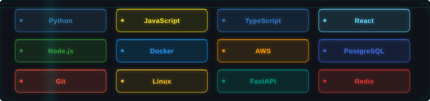

<!-- ═══════════════════════════════════════════════════════════════════════════ -->
<!--                    🚀 VISHAL CHOUDHARY's GitHub Profile                  -->
<!--              Animated · 3D · Creative · Built with Passion               -->
<!-- ═══════════════════════════════════════════════════════════════════════════ -->

<!-- ▀▀▀▀▀▀▀▀▀▀▀▀▀▀▀▀ 3D ANIMATED HEADER BANNER ▀▀▀▀▀▀▀▀▀▀▀▀▀▀▀▀ -->
<p align="center">
  
</p>

<!-- ▀▀▀▀▀▀▀▀▀▀▀▀▀▀▀▀ TYPING ANIMATION ▀▀▀▀▀▀▀▀▀▀▀▀▀▀▀▀ -->
<p align="center">
  <a href="https://git.io/typing-svg">
    
  </a>
</p>

<!-- ▀▀▀▀▀▀▀▀▀▀▀▀▀▀▀▀ SOCIAL BADGES ▀▀▀▀▀▀▀▀▀▀▀▀▀▀▀▀ -->
<p align="center">
  <a href="https://github.com/vishalchoudhary2910?tab=followers">
    
  </a>
  &nbsp;
  <a href="https://github.com/vishalchoudhary2910?tab=repositories">
    
  </a>
  &nbsp;
  
</p>

<br/>

<!-- ▀▀▀▀▀▀▀▀▀▀▀▀▀▀▀▀ ABOUT ME ▀▀▀▀▀▀▀▀▀▀▀▀▀▀▀▀ -->
<h2>
   
  &nbsp;About Me
</h2>

```javascript
const vishal = {
    pronouns: "he" | "him",
    location: "India 🇮🇳",
    currentFocus: "Building scalable systems & open-source tools",
    funFact: "I debug with console.log and I'm not ashamed 😄",
    
    skills: {
        languages:  ["Python", "JavaScript", "TypeScript"],
        frontend:   ["React", "Next.js", "TailwindCSS"],
        backend:    ["Node.js", "FastAPI", "Express"],
        databases:  ["PostgreSQL", "Redis", "MongoDB"],
        devOps:     ["Docker", "AWS", "GitHub Actions", "Linux"],
        currently:  "Exploring AI/ML & System Design"
    },
    
    dailyRoutine: () => {
        while (alive) {
            eat();
            code();
            sleep();
            repeat();
        }
    }
};
```

<br/>

<!-- ▀▀▀▀▀▀▀▀▀▀▀▀▀▀▀▀ TECH STACK — ANIMATED HOLOGRAPHIC CARDS ▀▀▀▀▀▀▀▀▀▀▀▀▀▀▀▀ -->
<h2>
  
  &nbsp;Tech Arsenal
</h2>

<p align="center">
  
</p>

<br/>

<!-- ▀▀▀▀▀▀▀▀▀▀▀▀▀▀▀▀ GITHUB STATS ▀▀▀▀▀▀▀▀▀▀▀▀▀▀▀▀ -->
<h2>
  
  &nbsp;GitHub Analytics
</h2>

<p align="center">
  <a href="https://github.com/vishalchoudhary2910">
    
    
  </a>
</p>

<p align="center">
  
</p>

<br/>

<!-- ▀▀▀▀▀▀▀▀▀▀▀▀▀▀▀▀ CODING ACTIVITY PULSE ▀▀▀▀▀▀▀▀▀▀▀▀▀▀▀▀ -->
<h2>
  ⚡ Activity Pulse
</h2>

<p align="center">
  
</p>

<br/>

<!-- ▀▀▀▀▀▀▀▀▀▀▀▀▀▀▀▀ CONTRIBUTION GRAPH ▀▀▀▀▀▀▀▀▀▀▀▀▀▀▀▀ -->
<h2>
  🐍 Contribution Snake
</h2>

<p align="center">
  <picture>
    <source media="(prefers-color-scheme: dark)" srcset="https://raw.githubusercontent.com/vishalchoudhary2910/vishalchoudhary2910/output/github-snake-dark.svg" />
    <source media="(prefers-color-scheme: light)" srcset="https://raw.githubusercontent.com/vishalchoudhary2910/vishalchoudhary2910/output/github-snake.svg" />
    
  </picture>
</p>

<br/>

<!-- ▀▀▀▀▀▀▀▀▀▀▀▀▀▀▀▀ GITHUB TROPHIES ▀▀▀▀▀▀▀▀▀▀▀▀▀▀▀▀ -->
<h2>
  🏆 Achievements
</h2>

<p align="center">
  
</p>

<br/>

<!-- ▀▀▀▀▀▀▀▀▀▀▀▀▀▀▀▀ CONTRIBUTION GRAPH (Activity) ▀▀▀▀▀▀▀▀▀▀▀▀▀▀▀▀ -->
<h2>
  📊 Contribution Graph
</h2>

<p align="center">
  
</p>

<br/>

<!-- ▀▀▀▀▀▀▀▀▀▀▀▀▀▀▀▀ CONNECT WITH ME ▀▀▀▀▀▀▀▀▀▀▀▀▀▀▀▀ -->
<h2>
  
  &nbsp;Let's Connect
</h2>

<p align="center">
  <a href="https://github.com/vishalchoudhary2910">
    
  </a>
  &nbsp;
  <a href="mailto:your.email@example.com">
    
  </a>
  &nbsp;
  <a href="https://linkedin.com/in/yourprofile">
    
  </a>
  &nbsp;
  <a href="https://twitter.com/yourhandle">
    
  </a>
</p>

<br/>

<!-- ▀▀▀▀▀▀▀▀▀▀▀▀▀▀▀▀ ANIMATED FOOTER ▀▀▀▀▀▀▀▀▀▀▀▀▀▀▀▀ -->
<p align="center">
  
</p>

<!-- ▀▀▀▀▀▀▀▀▀▀▀▀▀▀▀▀ WAVE FOOTER ▀▀▀▀▀▀▀▀▀▀▀▀▀▀▀▀ -->

